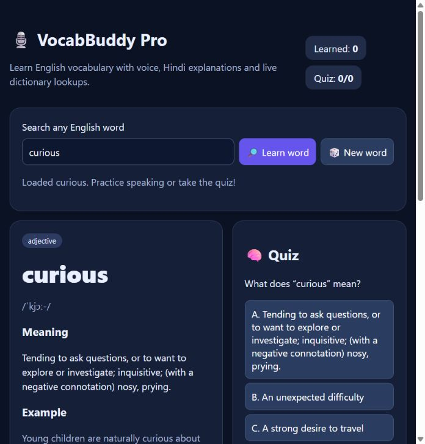

# 🎙️ VocabBuddy Pro

### Learn English vocabulary with voice and Hindi explanations.

**[🚀 Open VocabBuddy Pro](https://princearyan1.github.io/VocabBuddy-Pro/)** — use it directly in your browser, with no installation or account required.

VocabBuddy Pro is a lightweight vocabulary practice app for English learners. Look up words, understand their meanings with Hindi support, listen to pronunciation, and test yourself with a quick quiz.

## Features

- **Live dictionary:** English definitions, phonetics, and examples when available.
- **Hindi explanations:** Built-in explanations for selected words and translation through MyMemory when available.
- **Listen and practice:** Hear words and explanations, and practice pronunciation with browser speech recognition.
- **Vocabulary quizzes:** Multiple-choice questions with instant feedback and a session score.
- **Saved progress:** Mark words as learned and review them later in the same browser.
- **Command-based coach:** Ask for a meaning, an example, a Hindi explanation, or a new word.
- **Responsive layout:** Use the app on desktop or mobile.

## How to use

1. [Open the app](https://princearyan1.github.io/VocabBuddy-Pro/).
2. Search for an English word or select **New word**.
3. Read the meaning and Hindi explanation, then try **Hear word** or **Pronounce**.
4. Answer the quiz and select **Learned** to save the word.
5. Use **Review saved words** to practice again.

## Browser and privacy notes

Speech recognition works best in Chrome or Edge and requires microphone permission. Voice support depends on your browser and device. Dictionary and translation features require an internet connection; external services may occasionally be unavailable.

Learned words are stored in this browser's local storage, without account sync. Lookups and translations are sent to the respective dictionary and translation services. Browser speech recognition may use the browser provider's speech service. The coach responds to predefined commands; it is not a generative AI chatbot.

## Built with

HTML, CSS, and JavaScript, with browser speech APIs and local storage. Dictionary data is provided by [Free Dictionary API](https://dictionaryapi.dev/), with translations from [MyMemory](https://mymemory.translated.net/).

Hosted on GitHub Pages from the root of the `main` branch. The application is contained in `index.html`.

## Share

**Website:** https://princearyan1.github.io/VocabBuddy-Pro/

**Source code:** https://github.com/Princearyan1/VocabBuddy-Pro
